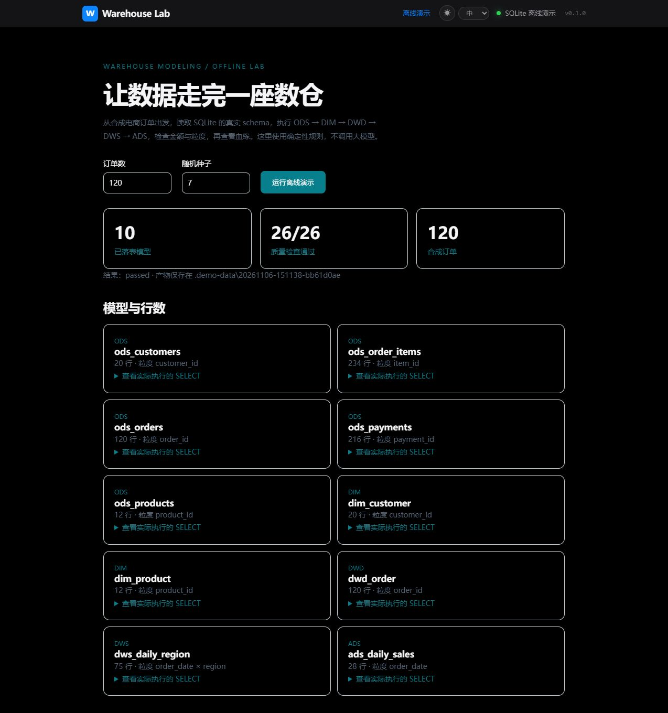

# Warehouse Modeling Agent

一个用于学习、验证和扩展的数仓建模项目。保留 LangGraph 建模工作流、结构化设计编译器、数据库工具、质量校验、人工确认、评估套件和 Vue 看板，同时提供**无需账号、模型或外部数据库的离线电商演示**。

[](https://github.com/zhyzx35607/warehouse-modeling-agent/actions/workflows/verify.yml)



## 三分钟运行

只需要 Python 3.11+。在项目根目录执行：

```powershell
python -m warehouse_demo
```

每次运行会在 `.demo-data/时间戳/` 新建 SQLite 数据库，并生成：

| 文件 | 内容 |
|---|---|
| `warehouse.sqlite` | 合成源数据与实际落表的 ODS、DIM、DWD、DWS、ADS |
| `schema.json` | 从 SQLite 元数据探查出的列、主键、外键、行数 |
| `model.json`、`warehouse.sql` | 结构化模型与实际执行的 SQL |
| `report.json`、`report.html` | 数据质量检查与每日销售结果 |
| `lineage.json`、`lineage.mmd` | 表级血缘 |

```powershell
python -m warehouse_demo --orders 300 --seed 42
python -S scripts/run_demo.py --orders 20
```

演示包含客户、商品、订单、订单明细和支付五张源表；订单含取消场景，成功订单使用拆分支付。实现先聚合明细和支付再关联，避免多对多连接造成金额翻倍。主键粒度、空值、外键、订单数和源目标金额都从数据库实际计算。校验失败返回非零退出码，已有数据库不会被覆盖。

输出目录必须是新目录或现有空目录，拒绝目录自身的符号链接。数据库、JSON、SQL 和 HTML 均以独占方式创建，已有同名产物不会被覆盖；HTTP 仅接受合法整数参数，非法输入不会创建输出目录。

## Vue 看板

首次构建需要 Node.js 20+ 和网络，之后运行演示不需要联网：

```powershell
cd dashboard
npm ci
npm run build
cd ..
python -m warehouse_demo --serve
```

打开 `http://127.0.0.1:8000/demo`，选择订单数和种子，运行后查看模型、检查、每日销售和血缘。服务仅监听本机。开发时可以运行 `npm run dev`，Vite 会将 API 代理到本地 8000 端口。

## Demo 与 Live 的边界

| | 离线演示 | Live 工作流 |
|---|---|---|
| 入口 | `python -m warehouse_demo` | `python run.py` |
| 规划 | 明确标注的确定性电商规则 | LangGraph + 真实模型调用 |
| 数据 | 新生成的 SQLite 合成数据 | 用户自行配置的源数据库 |
| SQL | SQLite，实际执行 | Doris，包含编译与校验 |
| 状态和知识 | 本地 JSON / SQLite | PostgreSQL、可选 Neo4j / embedding |
| 执行 | 本机同步落表 | 可配置 DolphinScheduler |

离线演示不是 LLM 效果评测，也不模拟远程部署成功。Live 模式不会自动进入演示。ODS/DIM/DWD 的模型故障默认向上抛出；DWS/ADS 保留已有的重试、校验和失败状态。所有分层设计节点在严格模式下重试耗尽或熔断时都会报错，由任务运行器记录失败，不能被通用恢复包装器跳过。可选的旧版程序回退只有显式设置 `LLM_ALLOW_PROGRAMMATIC_FALLBACK=true` 才启用，并写入 warning。

## 配置 Live

```powershell
python -m venv .venv
.\.venv\Scripts\python -m pip install -e .\vendor\cli-anything-dolphinscheduler
.\.venv\Scripts\python -m pip install -e ".[live,dev]"
Copy-Item .env.example .env
```

按自己的环境填写 `.env`：PostgreSQL 保存状态和注册表，Doris 作为目标数仓，DolphinScheduler 用于调度。仅看离线演示不需要这些服务。SM4 密钥由用户生成；仓库不提供生产凭据。PostgreSQL DSN 的 TLS 参数保持用户配置，不强制关闭 SSL。

支持 OpenAI 兼容端点（`custom` / `openai` / `deepseek`）和 Ollama；后者另装 `pip install -e ".[ollama]"`。模型提供商、模型名、上下文和输出上限须与实际服务一致。embedding 使用独立的 `LLM_EMBEDDING_API_BASE` / `LLM_EMBEDDING_API_KEY`，未配置时明确跳过语义补充；它不会误用聊天服务的地址。

```powershell
.\.venv\Scripts\python run.py
```

Live 工作台位于 `/live`，原有任务监控、人工澄清、审批、设计方案、报告、资产目录和指标库页面均保留。数据库变更和部署流程需要用户自行连接的服务；本次验证没有连接任何公司服务或真实业务数据。

## 保留的工程能力

- `wren_agent/graph.py`：建模状态机，浅层/深层探索、澄清、漂移检测、分层设计、校验修订、审批、部署、质量与报告。
- `wren_agent/compiler/`：语义设计到 Doris DDL/DML 的确定性编译、标识符/类型/源表约束。
- `wren_agent/tools/`：只读数据库探查、字段采样、LLM/embedding 接口、注册表、血缘、重试与调度适配器。
- `wren_agent/skills/`：11 份领域提示与校验规则；`eval/` 保留评估器和合成回归样例。
- `dashboard/`：Vue 3 界面；`warehouse_demo/` 是独立的标准库演示执行器。

来源改造修复了旧副本中 `@property` 被误替换、重复映射键、大小写/长度回归样例失真、评估输入缺失及 npm 完整性哈希被改写的问题。具体来源和许可范围见 [NOTICE.md](NOTICE.md)。

## 验证

```powershell
.\.venv\Scripts\python -m pytest tests -q
python scripts/verify_demo.py
cd dashboard
npm ci
npm run build
```

测试使用本地占位配置和模拟适配器。离线验证还会故意篡改汇总金额，确认质量检查能够发现失败。CI 分开验证无第三方依赖的演示、Python 单元测试和 Vue 构建。

本地验证：794 项 Python 测试通过；离线演示 10 个模型、26 项质量检查通过；Vue 生产构建通过。范围、依赖版本与未验证项见 [验证记录](docs/verification.md)。[简历与面试演示](docs/resume.md) 包含项目描述、架构图与三分钟演示步骤。

[English overview](README.en.md)
