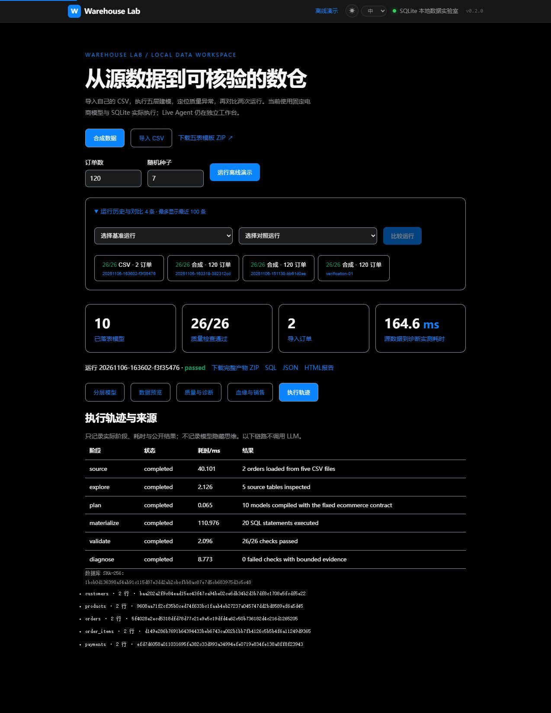

# Warehouse Modeling Agent

从源数据探查、分层建模到质量诊断的个人数仓 Agent 工作台。Live 路径保留 LangGraph、结构化 SQL 编译器、人工确认和数据库/调度适配器；**本地数据实验室可直接导入 CSV，实际落表、对账、比较运行并导出产物，无需模型或外部数据库。**

[](https://github.com/zhyzx35607/warehouse-modeling-agent/actions/workflows/verify.yml)



## v0.2 可操作的完整链路

| 功能 | 实际行为 |
|---|---|
| 导入自己的数据 | 五份 UTF-8 电商 CSV；先验证表头、整数范围、主键、日期与外键，再落入 SQLite；来源保存 SHA-256 |
| 分层建模 | ODS/DIM/DWD/DWS/ADS 共 10 个模型，20 条真实 DDL/索引语句，金额粒度检查 |
| 数据预览 | 源表与结果表的只读分页；SQLite `mode=ro` 和 `query_only`，仅允许已知表，不接受任意 SQL |
| 质量诊断 | 26 项检查、金额异常订单证据、沿血缘计算受影响模型；失败运行也保留用于调查 |
| 历史与对比 | 重启后重新打开结果，比较两次运行的行数、实收/应收、检查变化及 CSV 指纹 |
| 快照复检 | 对现有数据库重新只读校验，检测其 SHA-256 是否变化；初始报告保持不变 |
| 执行轨迹 | source → explore → plan → materialize → validate → diagnose 的真实阶段、耗时、状态与摘要 |
| 导出 | SQL、JSON、HTML、Mermaid 血缘及 SQLite 完整 ZIP；文件路径由服务端白名单控制 |
| 故障回归 | 12 个可重复的合成案例，分别检查金额漂移、丢行、重复粒度、空键、孤儿记录等 |

这里的 CSV 导入服从明确的五表电商契约，不是任意领域的自动建模；本地诊断来自 SQL 证据，不声称已经识别所有业务根因。完整操作与面试能力对应见 [功能与验证地图](docs/capabilities.md)。

## 导入 CSV 与复现异常

看板点击“下载五表模板 ZIP”，或使用仓库内 `examples/ecommerce-csv/` 的五份合成样例。网页选择“导入 CSV”并一次选中五份文件，点击“导入并建模”。也可以执行：

```powershell
python -m warehouse_demo --input-dir examples/ecommerce-csv
python -S scripts/verify_lab.py
python -S -m warehouse_demo.evaluate
```

样例包含 2 笔订单，已支付订单明细为 10000 分、拆分支付为 6000 + 4000 分。将自己的副本 `payments.csv` 中 6000 改为 5900 再导入，工作台会展示 `paid_order_balance` 失败、订单差额 -100 分及受影响的 DWD/DWS/ADS；两次结果可以直接比较。不会自动修改支付数据来制造“通过”。

导入总大小最多 4 MiB，订单最多 10000 行、其他表各最多 50000 行；CSV 列顺序遵循模板，金额以整数分表示。源 CSV 由浏览器发送到本机服务，不发给模型。运行保存在 `.demo-data/`；默认仅监听 `127.0.0.1`，当前为单机应用。

SQLite 和原始 JSON 产物保存整数分。HTTP 中超过 JavaScript 安全整数范围的值使用十进制字符串，页面以 BigInt 格式化金额，避免大金额在浏览器丢失一分钱。读取新 CSV 期间禁用导入，旧文件不会被误提交。

## 三分钟运行

只需要 Python 3.11+。在项目根目录执行：

```powershell
python -m warehouse_demo
```

每次运行会在 `.demo-data/时间戳/` 新建 SQLite 数据库，并生成：

| 文件 | 内容 |
|---|---|
| `warehouse.sqlite` | 合成源数据与实际落表的 ODS、DIM、DWD、DWS、ADS |
| `schema.json` | 从 SQLite 元数据探查出的列、主键、外键、行数 |
| `model.json`、`warehouse.sql` | 结构化模型与实际执行的 SQL |
| `report.json`、`report.html` | 数据质量检查与每日销售结果 |
| `lineage.json`、`lineage.mmd` | 表级血缘 |

```powershell
python -m warehouse_demo --orders 300 --seed 42
python -S scripts/run_demo.py --orders 20
```

演示包含客户、商品、订单、订单明细和支付五张源表；订单含取消场景，成功订单使用拆分支付。实现先聚合明细和支付再关联，避免多对多连接造成金额翻倍。主键粒度、空值、外键、订单数和源目标金额都从数据库实际计算。校验失败返回非零退出码，已有数据库不会被覆盖。

输出目录必须是新目录或现有空目录，拒绝目录自身的符号链接。数据库、JSON、SQL 和 HTML 均以独占方式创建，已有同名产物不会被覆盖；HTTP 仅接受合法整数参数，非法输入不会创建输出目录。

## Vue 看板

首次构建需要 Node.js 20+ 和网络，之后运行演示不需要联网：

```powershell
cd dashboard
npm ci
npm run build
cd ..
python -m warehouse_demo --serve
```

打开 `http://127.0.0.1:8000/demo`，选择订单数和种子，运行后查看模型、检查、每日销售和血缘。服务仅监听本机。开发时可以运行 `npm run dev`，Vite 会将 API 代理到本地 8000 端口。

## Demo 与 Live 的边界

| | 离线演示 | Live 工作流 |
|---|---|---|
| 入口 | `python -m warehouse_demo` | `python run.py` |
| 规划 | 明确标注的确定性电商规则 | LangGraph + 真实模型调用 |
| 数据 | 新生成的 SQLite 合成数据 | 用户自行配置的源数据库 |
| SQL | SQLite，实际执行 | Doris，包含编译与校验 |
| 状态和知识 | 本地 JSON / SQLite | PostgreSQL、可选 Neo4j / embedding |
| 执行 | 本机同步落表 | 可配置 DolphinScheduler |

离线演示不是 LLM 效果评测，也不模拟远程部署成功。Live 模式不会自动进入演示。ODS/DIM/DWD 的模型故障默认向上抛出；DWS/ADS 保留已有的重试、校验和失败状态。所有分层设计节点在严格模式下重试耗尽或熔断时都会报错，由任务运行器记录失败，不能被通用恢复包装器跳过。可选的旧版程序回退只有显式设置 `LLM_ALLOW_PROGRAMMATIC_FALLBACK=true` 才启用，并写入 warning。

## 配置 Live

```powershell
python -m venv .venv
.\.venv\Scripts\python -m pip install -e .\vendor\cli-anything-dolphinscheduler
.\.venv\Scripts\python -m pip install -e ".[live,dev]"
Copy-Item .env.example .env
```

按自己的环境填写 `.env`：PostgreSQL 保存状态和注册表，Doris 作为目标数仓，DolphinScheduler 用于调度。仅看离线演示不需要这些服务。SM4 密钥由用户生成；仓库不提供生产凭据。PostgreSQL DSN 的 TLS 参数保持用户配置，不强制关闭 SSL。

支持 OpenAI 兼容端点（`custom` / `openai` / `deepseek`）和 Ollama；后者另装 `pip install -e ".[ollama]"`。模型提供商、模型名、上下文和输出上限须与实际服务一致。embedding 使用独立的 `LLM_EMBEDDING_API_BASE` / `LLM_EMBEDDING_API_KEY`，未配置时明确跳过语义补充；它不会误用聊天服务的地址。

```powershell
.\.venv\Scripts\python run.py
```

Live 工作台位于 `/live`，原有任务监控、人工澄清、审批、设计方案、报告、资产目录和指标库页面均保留。数据库变更和部署流程需要用户自行连接的服务；本次验证没有连接任何公司服务或真实业务数据。

## 保留的工程能力

- `wren_agent/graph.py`：建模状态机，浅层/深层探索、澄清、漂移检测、分层设计、校验修订、审批、部署、质量与报告。
- `wren_agent/compiler/`：语义设计到 Doris DDL/DML 的确定性编译、标识符/类型/源表约束。
- `wren_agent/tools/`：只读数据库探查、字段采样、LLM/embedding 接口、注册表、血缘、重试与调度适配器。
- `wren_agent/skills/`：11 份领域提示与校验规则；`eval/` 保留评估器和合成回归样例。
- `dashboard/`：Vue 3 界面；`warehouse_demo/` 是独立的标准库演示执行器。

来源改造修复了旧副本中 `@property` 被误替换、重复映射键、大小写/长度回归样例失真、评估输入缺失及 npm 完整性哈希被改写的问题。具体来源和许可范围见 [NOTICE.md](NOTICE.md)。

## 验证

```powershell
.\.venv\Scripts\python -m pytest tests -q
python scripts/verify_demo.py
cd dashboard
npm ci
npm run build
```

测试使用本地占位配置和模拟适配器。离线验证还会故意篡改汇总金额，确认质量检查能够发现失败。CI 分开验证无第三方依赖的演示、Python 单元测试和 Vue 构建。

本地验证：815 项 Python、5 项 JavaScript 测试通过；离线演示 10 个模型、26 项质量检查通过；Vue 生产构建通过。范围、依赖版本与未验证项见 [验证记录](docs/verification.md)。[简历与面试演示](docs/resume.md) 包含项目描述、架构图与三分钟演示步骤。

[English overview](README.en.md)
