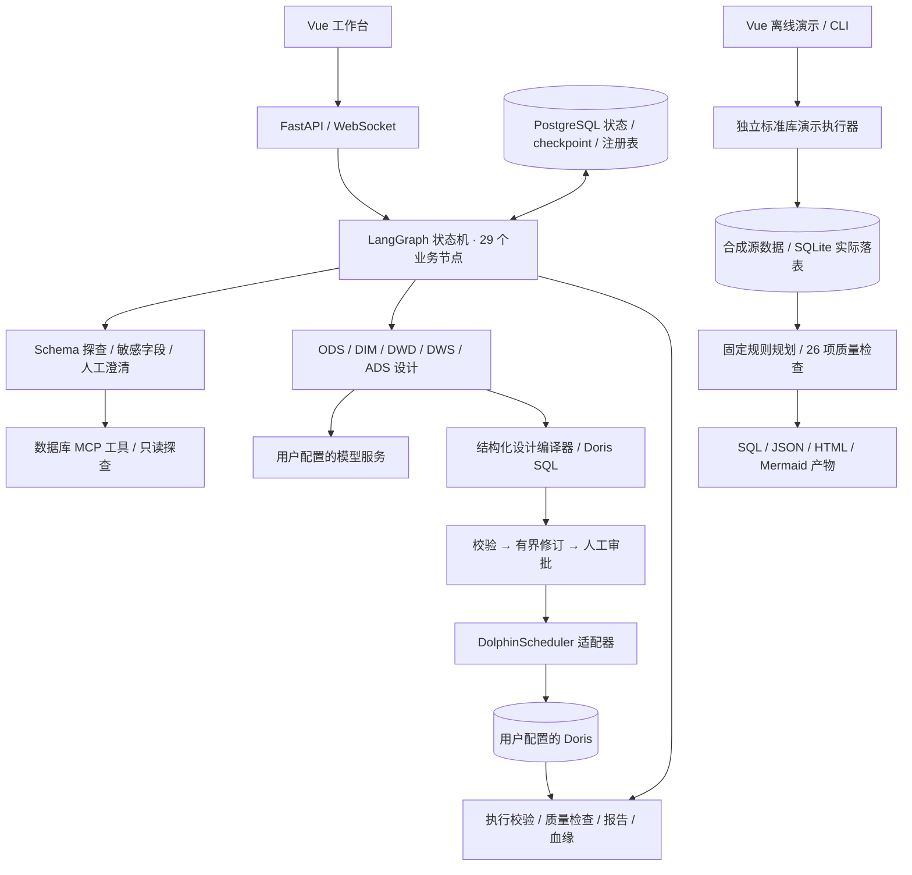

# 简历与面试演示

项目定位：基于既有数仓建模 Agent 进行个人化整理、质量修复与可复现演示建设。原有代码、个人新增部分和第三方组件的来源见 [NOTICE.md](../NOTICE.md)。下面的表述不包含未经测量的性能、生产规模或模型准确率。

## 可用于简历的三条描述

- 维护并改造基于 LangGraph 的数仓建模 Agent，保留 29 个业务节点构成的探索、人工澄清、分层设计、校验修订、审批、执行与报告流程；修复 Python 属性、MCP 接口及关键模型失败被恢复逻辑跳过的问题，使失败能够进入明确的任务失败状态。
- 实现无需外部服务的 SQLite 电商演示：从真实元数据探查到 ODS/DIM/DWD/DWS/ADS 共 10 个模型落表，输出 SQL、结构化模型和表级血缘；通过先聚合订单明细及拆分支付再关联避免金额重复，26 项质量检查验证粒度、外键及源目标金额一致性。
- 保留并修复 Python 回归测试与 Vue 3 工作台，在独立环境完成 794 项测试和前端生产构建；新增标准库 CLI/HTTP 冒烟检查、金额篡改检测及分离的 CI 任务，提供可重复运行、边界明确的项目展示入口。

建议按自己实际参与的工作调整动词与范围；本仓库没有测量企业部署规模、成本节省或 LLM 建模准确率。

## 架构

Live 图和离线执行器是两个入口。离线规则不调用 LLM；它验证数据流、聚合设计和工程可复现性。Live 的第三方服务端到端效果需要单独配置和测量。

## 三分钟演示

提前构建看板：在 `dashboard/` 执行 `npm ci` 和 `npm run build`。以下命令从仓库根目录运行。

1. **0:00—0:30，说明边界并启动。** 执行 `python -m warehouse_demo --serve`，打开 `http://127.0.0.1:8000/demo`。说明本次使用合成电商数据与规则规划，Live 架构另在工作台及源码中展示。
2. **0:30—1:20，运行实际数据链路。** 保持 120 订单、种子 7，点击“运行离线演示”；展示 10 个已落表模型、26/26 质量结果和各层行数。
3. **1:20—2:10，解释一个设计取舍。** 展开 `dwd_order` 的 SQL：订单明细和支付分别按 `order_id` 聚合后再关联。若直接连接两张一对多表，金额会随连接行数放大；这里用应收与实收对账验证结果。
4. **2:10—2:40，证明失败可检测。** 运行 `python -S scripts/verify_demo.py`。该脚本实际修改汇总金额，确认对账失败；同时检查 HTTP 成功、非法输入和离线服务器拒绝 Live 端点的路径。
5. **2:40—3:00，交代工程证据。** 打开本次 `.demo-data/` 下的 `warehouse.sql`、`schema.json`、`report.json` 和 `lineage.mmd`；说明 Python 测试、Vue 构建的结果与未完成的真实服务联调范围。

## 五个面试设计问题

1. **为什么采用状态图而不是把所有步骤写在一个大提示词中？** 探查、澄清、审批和重试具有不同的停止条件；状态、checkpoint 和路由让中间产物可观察、可恢复。可定位 `wren_agent/graph.py`、`engine.py` 和 `state.py` 说明职责。
2. **如何处理模型编造字段或 SQL？** 结构化设计受源表、列、类型和粒度约束，交由编译与校验流程处理；模型异常默认抛出，关键设计节点的重试耗尽或熔断不会静默跳过。它降低风险，但不等于已经证明所有模型输出正确。
3. **如何避免事实表关联导致金额膨胀？** 先明确每张表的业务粒度，对订单明细和多笔支付分别聚合，再连接订单；离线检查对比源表总额与 ADS 总额，并通过实际篡改记录证明校验会失败。
4. **自动修订与人工确认的边界在哪里？** 图中设计修订次数上限为 3；阻塞澄清、深层探索确认和审批是显式节点。错误分类、重试和审批路由各自处理不同的失败原因，不能用重试掩盖错误 SQL。
5. **离线演示能证明什么，不能证明什么？** 能证明 schema 探查、SQL 落表、聚合对账、产物生成与本地 HTTP 链路实际可运行；不能证明 LLM 的泛化质量，也不能替代 PostgreSQL、Doris、DolphinScheduler 与真实模型的完整联网验收。

完整验证记录见 [verification.md](verification.md)。
